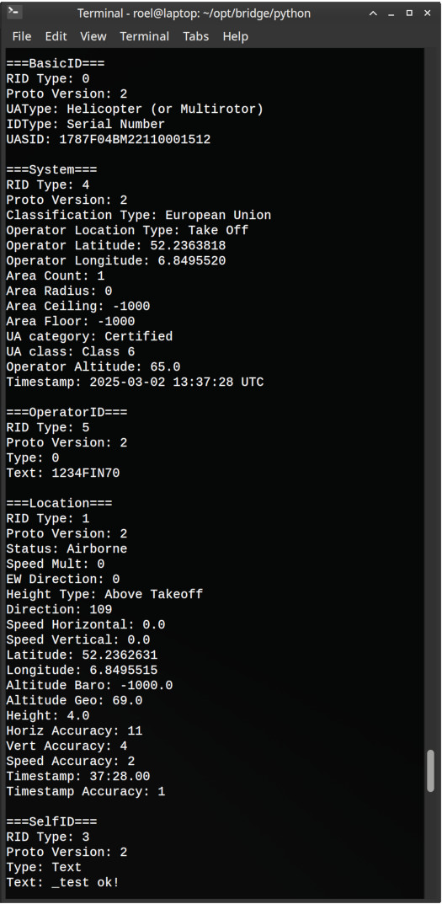
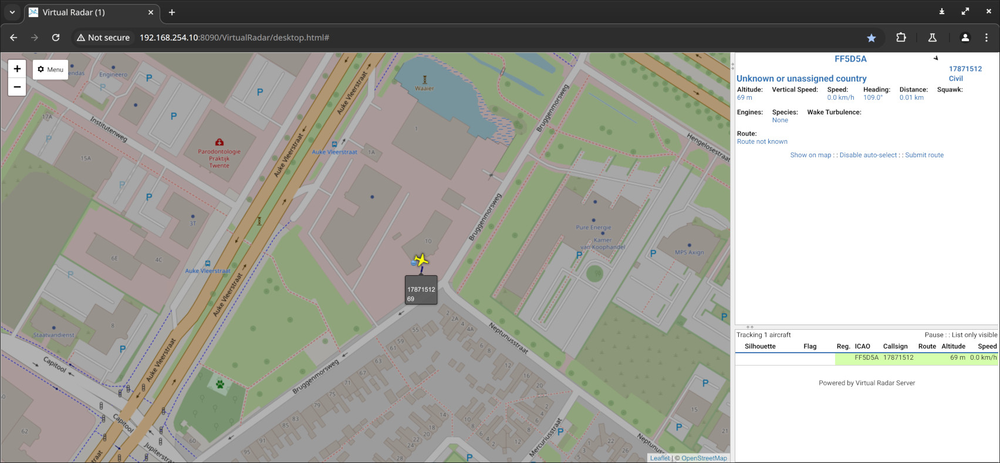

# RemoteID-DroneScout-Bridge-python


## What is it?
This repository contains Python reference code to parse and display data of DroneScout Bridge receiver dongles (Technical: [MAVLink ADS-B vehicle](https://mavlink.io/en/messages/common.html#ADSB_VEHICLE) or [MAVLink OpenDroneID](https://mavlink.io/en/services/opendroneid.html) messages). It is a basic application that only displays the payload of these messages. It can also save detected signals to a CSV file. A similar application written in C can be found here: [RemoteID-DroneScout-Bridge-C](https://github.com/BluemarkInnovations/RemoteID-DroneScout-Bridge-C). In firmware 20261027-1727 and higher a new packet has been defined: OPEN_DRONE_ID_RADIO_RX_INFORMATION. Its definition can be found in [rid.xml](./mavlink/rid.xml) and is fully supported by this Python code. This radio information packet includes additional information like RSSI and radio technology. Note: this packet is still work in progress, so its definition may still change in future firmware versions.


The DroneScout-Bridge receiver dongles can be purchased at [https://dronescout.co/bridge/](https://dronescout.co/bridge/). The manual can be found here: [manual](https://download.bluemark.io/ds_bridge.pdf)


DroneScout Bridge receivers detect broadcast/direct drone Remote ID signals (Bluetooth, WLAN); a <em>"wireless number plate"</em> technology that is mandatory in several parts of the world e.g. USA, EU, Japan, China. See this [page](https://dronescout.pro/regulations/) for a worldwide overview of Remote ID regulations. There are cost-effective single band devices, but also triple band devices that support the 2.4 GHz, 5 GHz and 5.8 GHz frequency bands. All transmission protocols (WLAN Beacon, Bluetooth 4 Legacy, Bluetooth 5 Long Range) are supported.


### DroneScout receivers vs DroneScout bridge
[DroneScout receivers](https://dronescout.co/) are designed for fixed installation with large detection range and support for all protocols and frequency bands. DroneScout bridge is designed to be a low-cost RemoteID receiver dongle in situations where there is only one RemoteID drone. In case of multiple drones, the data refresh rate can be much slower.


### Applications
DroneScout bridge has several use cases:

   - <i>wireless relay</i>: Most iOS and Android phones only receive RemoteID signals in Bluetooth legacy format. DroneScout Bridge can receive RemoteID signals (WLAN Beacon, Bluetooth Long Range) and wireless relay them in a format that your smartphone understands. You can use our [DroneScout pro app](https://dronescout.pro/) (iOS, iPadOS, Android) or your favorite RemoteID app.

   - <i>RemoteID receiver for your drone</i>: Install the DroneScout bridge on your drone and use it for DAA (Detect And Avoid) scenarios. The device allows outputting data using MAVLink ADS-B vehicle format on an UART or USB interface.

   - <i>RemoteID receiver for your own application/product</i>: Connect the DroneScout Bridge to your processing platform (computer, Raspberry Pi etc). The device allows outputting data using MAVLink OpenDroneID format on an UART or USB interface. Use this data to collect RemoteID data of nearby drones. DroneScout Bridge allows to connect multiple DroneScout Bridge devices by using the IN and OUT UART connectors.

#RemoteID #FAA #F3411 #DIN_EN_4709-002 #GB46750 #dronetechnology #DAA_DetectAndAvoid


## Installation
The code is Python3 code. It needs these dependencies (tested under Ubuntu):

```
sudo pip3 install pymavlink pyserial
```


## Configuration

In the config.py file, enter the correct settings for the ``interface``: ``/dev/ttyUSB0`` (default) when the bridge is connected via its UART interface with a USB-UART adapter, or ``/dev/ttyACM0`` when it is connected via its USB port. If you want to save detected RemoteID signals to a CSV file, uncomment ``log_path``.

MAVLink packets that could not be decoded are reported as decode errors. This covers packets with an invalid CRC or length, bytes outside a MAVLink packet, unknown message IDs and gaps in the MAVLink sequence numbers (lost packets). Consecutive bytes outside a MAVLink packet are reported as one error.

Decode errors are shown on the console, together with the received messages. Set ``print_messages = False`` in config.py to hide both the received messages and the decode errors on the console. When ``log_path`` is set, decode errors are also logged to a separate ``*_decode_errors.csv`` file, independent of ``print_messages``. The raw bytes are saved as hex, which helps to diagnose corruption on the serial link.


## Usage
Start the script to receive and show Remote ID signals of nearby drones.

```
python3 main.py
```



### SBS BaseStation
The Python code can also output data via [SBS BaseStation](http://woodair.net/sbs/article/barebones42_socket_data.htm) on a net socket. To enable this, uncomment the variables ``sbs_server_ip_address`` and ``sbs_server_port`` in config.py. Normally you only need to change the port. The IP address needs to be an IP address of the computer where this script runs. Only change it if you want to have the SBS BaseStation export available on a particular network interface.

This export data format is used by programs that display ADS-B data from airplanes. Examples of such programs that support this data format are: [Virtual Radar Server](https://www.virtualradarserver.co.uk/) and [FlightAirMap](https://www.flightairmap.com/). A typical use case is when you want to view both ADS-B data from airplanes and RemoteID signals from drones in one application. To configure a SBS BaseStation receiver in Virtual Radar Server, see this [link](https://www.virtualradarserver.co.uk/Documentation/WebServer/ReceiversOptions.aspx).

Note: for exporting data, the normal Serial Number of RemoteID is too long. It is decided in this implementation to use an ICAO code starting with FF. This range is **not** assigned to a country. The remaining 4-digits in the ICAO code are based on the Serial Number of the drone (hash). In this way, each drone has its own unique ICAO code. The 8-character call sign is based on the first 4 digits of the Serial Number (manufacturer code) and the last 4 digits.




## Firmware upgrade
The ``firmware_upgrade.py`` script uploads a new firmware image to the DroneScout Bridge using [MAVLink FTP](https://mavlink.io/en/services/ftp.html). Before uploading, it checks that the file is a valid firmware image for the connected bridge model. The bridge then erases its firmware update partition, receives the image, validates it and selects it for the next boot. Finally the script reboots the bridge to start the new firmware.

The script uses the ``interface`` and ``baudrate`` settings from config.py, which can be overridden with ``--device`` and ``--baudrate``.

```
python3 firmware_upgrade.py firmware.bin    # upload new firmware and reboot the bridge
python3 firmware_upgrade.py --info          # show model, hardware/firmware version and serial number
python3 firmware_upgrade.py --reboot-only   # only reboot the bridge
```

Run ``python3 firmware_upgrade.py --help`` for all options.

**Note:** firmware upgrade is only supported in firmware 20261027-1727 or higher.

**Note:** firmware upgrade via the USB port of the bridge does **not** work due to hardware limitations. The USB port only sends data; it does not receive MAVLink commands. Connect the bridge via its UART interface instead, for example with a USB-UART adapter.

**Warning:** do **not** use esptool to flash the bridge directly. This will break the device. Always use ``firmware_upgrade.py`` to upgrade the firmware.


## Tests
Run the unit tests from the repository root (no hardware needed):

```
python3 -m unittest
```
